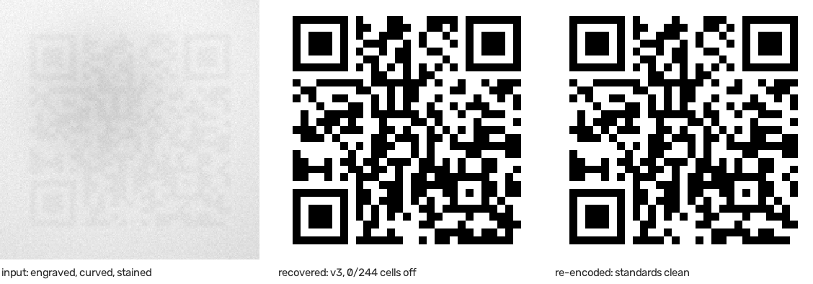

# qrsalvage

[](https://github.com/<owner>/qrsalvage/actions/workflows/ci.yml)

*recover QR codes from what's left of them*

A QR code laser-engraved onto the curved dome of a light bulb. Grey on white, roughly nine
pixels per module in the only photograph that exists of it, a glare gradient across the middle
and a yellowed stain over one corner. No phone reads it. No online decoder reads it. It took
its owner a year and a half.

qrsalvage reads codes like that.



## What it does differently

Ordinary decoders are all-or-nothing: they binarise the image, sample a grid, and either return
a string or nothing at all. When they fail you learn nothing about why.

qrsalvage takes the problem apart:

- **It calibrates on what the standard already fixes.** In a version 3 code, 244 of the 841
  cells have a value the specification determines — finders, separators, timing, alignment.
  Their true values are known, so they can be used to measure whether the grid, the version and
  the brightness model are right. Every step is scored against them.
- **It fits the grid by search, not by formula.** A homography cannot represent a curved
  surface. So the four corners are nudged by coordinate descent until the known cells sit as
  well as they can. On the bulb photograph that took the sampling error from 18 wrong cells
  down to 2, and only then did the code decode.
- **It does not decide what it does not know.** Each module gets a probability, not a verdict.
  Cells that stay in doubt become *erasures* — and Reed-Solomon repairs twice as many erasures
  as it does errors, because their position is already accounted for.
- **It tells you how sure it is.** Every run reports how many known cells it got wrong, whether
  the timing pattern is intact, how many cells remain uncertain and what the repair had to do.

Everything that could be guessed is measured instead, and scored on the same evidence:

- **The version**, by fitting every candidate size and comparing the error count. On a bad
  photograph the estimate from the finder width lands between two candidates about as often as
  it lands on one.
- **The resolution.** A finder is seven modules wide, so once one is found the module size is
  known. Photographs are rescaled into the band the preprocessing is built for — in both
  directions. Codes fail as readily for being photographed too well as too badly.
- **The polarity.** Light modules on a dark ground, as etched into metal or dark plastic, are
  read as easily as dark on light. This cannot be settled by looking at the finders — a finder
  is nested squares and so is its inverse — so it is settled by the known cells like everything
  else.
- **A missing finder.** Two are enough. A QR code is square, which fixes the third position up
  to six discrete choices; all six are fitted and the known cells pick the winner.

## Install

```
pip install qrsalvage
```

From source:

```
git clone https://github.com/<owner>/qrsalvage
cd qrsalvage
pip install -e .
```

Requires Python 3.11 or newer. Dependencies: NumPy, OpenCV, Pillow, zxing-cpp.

## Use

```
qrsalvage solve photo.jpg
```

That is the whole first step. If fewer than three finder patterns are found, narrow the search
with `--crop X0 Y0 X1 Y1`; the finder search does not cope well with busy backgrounds.

In the browser there is a camera button for exactly this: one press takes four frames over
two seconds while your hand drifts around the code — angle variation for free, read together.
On the command line, pass the photographs yourself:

```
qrsalvage solve photo1.jpg photo2.jpg photo3.jpg
```

Photographs taken from different angles get *different* cells wrong, and where they disagree the
fused reading lands near a half — which is exactly what the search needs to be told. This is the
only ensemble in the project with a positive measurement behind it. Three photographs against
one, over fourteen trials per level:

| damage | one photograph | three, fused |
|---|---|---|
| glare and low contrast | 62 % | 93 % |
| a heavy stain | 52 % | 100 % |
| a heavier stain | 36 % | 86 % |

Re-photograph from a **different angle and in different light**. A burst from the same position
buys nothing: the dominant error is the grid, every frame inherits the same one, and three
copies of one mistake are still one mistake. The same reasoning explains why the stain rows gain
more than the contrast rows — poor contrast spoils every cell of every photograph alike, while a
stain sits somewhere else each time, so what one photograph loses the others still hold.

Or drop the photograph onto a page in your browser:

```
qrsalvage serve
```

That opens a local interface on `127.0.0.1` — and only there. The payload of a damaged code is
frequently a secret, so nothing is uploaded and the port is not reachable from another machine.
The page shows the same diagnostics as the command line, with a one-line verdict on top, and
drops of several photographs are read together exactly like the command line reads them. If the
finder search comes up short you can click the three corner squares yourself. Roughly is
enough: the click picks which candidate to use, the position still comes from the image.

Export the result:

```
qrsalvage solve photo.jpg --export svg pdf json html --size-mm 40
```

`--size-mm` is not decoration. Whether a printed code scans is decided by the physical width of
a module, not by the pixel count of the file — the bulb this project started with had modules
about 1.4 mm across. SVG and PDF carry that size for real; the PNG is for sharing. `json` gives
the payload alongside the figures that say how much to trust it, and `html` is a self-contained
report showing the photograph, the recovered matrix and the evidence between them.

Recognised payloads — Zigbee install codes, Matter onboarding codes, Wi-Fi credentials — are
explained next to the recovered text: what the code is and where one types it. For Matter that
includes the derived 11-digit *manual pairing code*, which is precisely what a person whose
code cannot be scanned needs. In the JSON export the split is opt-in via `--split-payload`:
install codes, passcodes and network keys are secrets, not identifiers.

Turn a pile of photographs of *different* codes into a printable register:

```
qrsalvage catalog lampe.jpg heizung.jpg tor.jpg --titles "LED Lampe Bad" "Heizung" "Gartentor"
```

Every photograph is recovered on its own and the result is one A4 PDF, three entries per page:
the re-encoded code at a real physical size on the left, its content on the right, your title
above — because the payload identifies the code, but the title identifies the lamp. Duplicate
photographs of one code fold into a single entry, and titles default to the file names. The
same catalogue is built in the browser: drop the pile, switch to "different codes", name each
card, download.

Generate an artificially degraded test case with a known answer:

```
qrsalvage synth "HELLO-WORLD" --contrast 0.14 --curvature 0.4
```

## Reading the output

```
chosen: version 3 (29 modules)
known cells wrong: 2 of 244 (grid fit)
timing pattern:    100.0 %
uncertain cells:   4 of 841 (band 0.15)
decode attempts:   1
```

- **The version table** above this block has to show a clear winner. If two candidates are
  close, the grid is not seated and nothing below it means anything.
- **Known cells wrong** is the one number that measures the method honestly. Below 1 % is
  healthy; above 5 % points at a geometry problem, not a contrast problem.
- **Timing pattern** below 100 % means grid drift, even when the image looks plausible.
- **Decode attempts** above 1 means the direct read failed and the repair or the ordered probe
  had to work for it.

`out/grid.txt` holds the sampled matrix as `#`, `.` and `?` — the third symbol marks cells the
tool refuses to guess. `out/clean.png` is the payload re-encoded from scratch, which is a
guaranteed-valid code rather than a reconstruction that happened to pass.

## How well it works

Measured on synthetic cases with known answers, varying contrast while holding the other damage
constant, 20 images per level. `contrast` is the fraction of full black the engraving reaches;
the real bulb photograph sits near 0.15.

| contrast | solved | rate | 95 % interval |
|---|---|---|---|
| 0.30 | 20/20 | 100 % | [84 %, 100 %] |
| 0.24 | 20/20 | 100 % | [84 %, 100 %] |
| 0.20 | 20/20 | 100 % | [84 %, 100 %] |
| 0.16 | 20/20 | 100 % | [84 %, 100 %] |
| 0.13 | 18/20 | 90 % | [70 %, 97 %] |
| 0.11 | 15/20 | 75 % | [53 %, 89 %] |
| 0.09 | 7/20 | 35 % | [18 %, 57 %] |

The fall-off is a ramp, not a cliff: between 0.16 and 0.09 the rate drops across four levels.
A single run at either end would have reported "works" or "does not work" and both would have
been true.

Reproduce with `python scripts/difficulty.py --axis contrast`. Other axes: `curvature`,
`resolution`, `stain`.

The intervals matter. Even 20 successes out of 20 only supports "at least 84 %" — a claim built
on four samples, which is what an earlier version of this table used, supports almost nothing.

### Where it stops

Under otherwise ideal conditions — high contrast, barely any curvature, little noise — the
limit is resolution:

| pixels per module | recovered |
|---|---|
| 6.0 | 5/5 |
| 5.0 | 5/5 |
| 4.0 | 1/5 |
| 3.0 | 0/5 |

**Below about five pixels per module there is nothing to recover.** Not "hard": the information
is no longer in the image. That number is worth knowing before you spend an evening on a
photograph — it tells you to take a better one instead. Real damage moves the threshold upward,
never down.

### On real photographs

Thirteen damaged codes collected from the web and from hardware labels, of which a plain
decoder reads exactly one:

|  | |
|---|---|
| recovered by qrsalvage | 6 of 13 |
| recovered by a plain decoder | 1 of 13 |
| grid seated within 5 % of known cells | 9 of 13 |
| failed to locate the code at all | 0 of 13 |

Of the seven not recovered, one sits below the resolution floor above and the rest place the
grid cleanly — one at 1 of 252 known cells wrong with an intact timing pattern — and fail
because too many data modules are physically gone. That is the honest boundary of the method:
it can find and place a code far past the point where it can read one.

## Related projects

qrsalvage is not the first tool in this space, and the honest comparison is short:

- **[QRazyBox](https://github.com/Merricx/qrazybox)** — open source, the reference tool for QR
  forensics. You transcribe the matrix by hand in a paint-like editor, then it brute-forces the
  format information and recovers data through erasures. Excellent at the analysis half; it does
  no image processing at all.
- **[QR Photo Restore](https://www.hashitosystem.com/en/tools/qr-restore/)** — closest in
  approach: flat-fielding, a binarisation sweep, a four-point homography, confidence-ranked
  erasures. Runs in the browser, free, but no source and no licence.
- **[EAN Check](https://eancheck.com/qr-code-recovery)** and commercial SDKs such as Dynamsoft
  cover similar ground behind closed doors.

What qrsalvage adds: **curved surfaces** (the others stop at a plain homography), a
**reproducible benchmark** so improvements can be quantified rather than asserted, and an open,
scriptable pipeline with a text interface that automation can drive.

## Limitations

- **About five pixels per module is the floor**, measured above. Below it, no algorithm helps.
- **QR Code only.** Not Data Matrix, Aztec or PDF417. The method generalises but each symbology
  needs its own structure model, layout and Reed-Solomon parameters.
- **Reed-Solomon repair covers versions 1 to 10.** Larger codes are read but not repaired; the
  block tables stop there.
- **A cluttered background can still defeat the finder search.** `--crop` is the workaround, and
  the browser interface lets you point at the finders instead.
- **The fallbacks are slow.** Recovering from two finders fits six times as many grids and takes
  around twenty seconds; the ordinary path takes four.

## Contributing

Start with [`docs/ARCHITECTURE.md`](docs/ARCHITECTURE.md) — the whole system on one page,
including the reading order and a "where do I change…" table — and with
[`CONTRIBUTING.md`](CONTRIBUTING.md), whose first section is your first hour.

The test corpus in `fixtures/` is entirely synthetic and regenerated by
`python scripts/make_fixtures.py`. That is deliberate: real photographs of damaged QR codes are
almost always personal, and the decoded content is frequently a secret. Please do not add real
photographs to the repository.

```
pip install -r requirements.txt
ruff check . && ruff format --check .
pytest                      # everything
pytest -m "not regression"  # fast
```

If you change anything in the recovery path, run `python scripts/difficulty.py` before and
after. A change that cannot be measured is a change that cannot be reviewed.

## Licence

Apache License 2.0. See [LICENSE](LICENSE) and, for what this software stands on,
[THIRD-PARTY-NOTICES.md](THIRD-PARTY-NOTICES.md) — everything in that list is permissively
licensed, which is what makes it possible to offer qrsalvage as free software, in a browser,
funded by donations rather than by your photographs.
